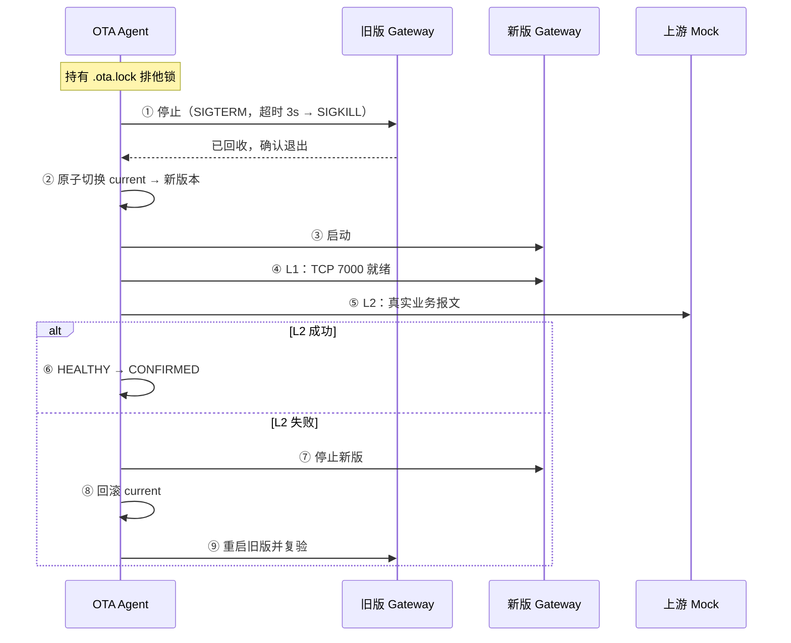

# D25-2 方案设计 · Gateway 进程生命周期管理

> 项目：SmartGateway-BSP / 100ASK i.MX6ULL
> 分支：`feature/bsp-imx6ull`
> 文档性质：**设计文档（DESIGN）**，不是验收报告
> 状态：**方案设计与原型验证完成；主体未实现**。
> 前置：[D25-1](D25-1-arm-build-deployment-validation.md)、[D25-1B](D25-1B-board-environment-recheck.md)

## 0. 为什么先写设计而不写代码

本文档初稿写于 D25-1B 板端仍不可达之时。当时进程生命周期管理的设计
**不依赖板端即可完成**，因为它的约束来自代码与系统语义，而非硬件行为。

**D25-1B 已恢复板端连接并完成实测**，因此原本待确认的关键参数
（`/opt` 是否持久、Gateway 由谁启动、用哪套 init）现已全部有了答案，
见第 2.1 节。这些答案**没有推翻原设计**，只填实了原先预留的分支。

有一条硬约束始终成立：**设计必须做到"参数可配置、缺省安全"**，
不能把未经证实的假设写死。

### 0.1 一个必须说清的边界：x86 OTA 验证 ≠ 板端 OTA 验证

x86 上的 OTA 流程（D23-6-8）已经过**真实的北向 TCP 故障注入**，
验证了「L1 通过但 L2 业务失败 → 自动回滚 → 旧版恢复业务」这条路径。
但那是**宿主机 x86 环境**，且用的是手工构造的 install 目录。

**板端至今没有执行过完整升级流程。** D25-1B 在板端做的是：

| 板端已做 | 板端未做 |
| --- | --- |
| 部署二进制并执行 `--version` | 完整 `stage → activate → health → confirm` |
| `verify` 校验包（含 4 个负向用例） | 真实版本切换（`current` 软链原子切换） |
| 隔离启动 Gateway（19000 端口） | 升级过程中的优雅停止 / 重启旧版 |
| 确认 `/opt` 跨重启持久 | 健康检查失败后的板端回滚 |
| 确认无 init 脚本、BusyBox init | 重启后状态机自洽性验证 |

因此**不能**说"OTA 已在板端验证"。正确的表述是：
**x86 已验证，板端未验证**，这项工作排在 D25-2 完成之后。

写成这个顺序的理由：没有 supervisor 与 pidfile，
板端做完整升级会遇到"旧版停不下来"或"停下来了但无法确认"的问题，
测试结果会失真。先把进程所有权做扎实，再上板端跑全流程。

---

## 1. 现状：已有能力与关键缺口

### 1.1 已有能力（`ota_process.c` / `ota_health.c`）

| 能力 | 实现 | 质量评价 |
| --- | --- | --- |
| 启动子进程 | `fork` + `execv` + CLOEXEC 错误管道 | 好：exec 失败能准确回报 errno |
| 优雅停止 | SIGTERM → 轮询 `waitpid(WNOHANG)` → 超时 SIGKILL | 好：有超时、有 elapsed 计时 |
| 回收子进程 | `waitpid` | 好：避免僵尸 |
| 存活检测 | `waitid(WNOHANG \| WNOWAIT)` | 好：不破坏退出状态 |
| L1 健康 | TCP connect 到 7000 | 合理：就绪检测 |
| L2 健康 | 真实业务报文往返 | 好：不是开关伪造 |

这部分代码质量不错，D25-2 应当**复用而不是重写**。

### 1.2 关键缺口：`ota_process_stop` 只对自己的子进程有效

这是本方案的核心起点。`ota_process.c:163` 的注释写得很清楚：

```c
/*
 * 必须是当前进程创建且尚未回收的子进程。
 * 避免根据进程名称误杀其他 Gateway。
 */
result = wait_child(pid, &status, WNOHANG);
```

`waitpid()` 的语义决定了这一点：**你只能 wait 自己的子进程**。
如果 Gateway 是系统启动的（init 脚本、systemd、`rcS`），
它和 OTA Agent 之间**没有父子关系**，`ota_process_stop()` 对它完全无效。

于是出现一个必须正面回答的问题：

> **正式部署中，Gateway 到底由谁启动？**

D23 的实验里 Gateway 是 OTA Agent 自己 fork 的（`Gateway started: pid=42743`），
那是**测试形态**。正式形态大概率是 init 启动的常驻进程。
两者的进程管理方式完全不同，**不能混为一谈**。

### 1.3 其他缺口

| 缺口 | 现状 | 后果 |
| --- | --- | --- |
| **无 pidfile** | 全仓库 `grep` 无 `pidfile`/`.pid`/`/var/run` | OTA 无法可靠找到"正在运行的 Gateway" |
| **`ota_recover` 不检查进程** | `ota_recover.c` 无 `kill`/`pid`/`running` 相关代码 | 可能在 Gateway 正运行时切换 `current` 软链 |
| **无单实例保护** | Gateway 无 pidfile、无 flock | 可能起两份，第二份因 7000 端口冲突退出 |
| **端口固定 7000** | `GATEWAY_WIFI_PORT` 编译期常量 | 无法并存测试，见 D25-1 R3 |
| **无看门狗/重启** | 无 supervisor | Gateway 崩溃后无人拉起 |
| **无启动超时回滚** | 仅测试流程有 health | 正式启动失败无自动恢复 |

---

## 2. 必须先回答的四个未知

> **2026-11-06 更新**：板端已恢复，四项未知中的三项已由
> [D25-1B](D25-1B-board-environment-recheck.md) 实测回答。
> 下表保留原始设计意图，实测结果见 2.1。

| # | 未知项 | 影响 | 若为 A | 若为 B |
| --- | --- | --- | --- | --- |
| U1 | `/opt`（或选定目录）是否跨重启持久 | OTA 能否工作 | 持久 → 直接用 | 不持久 → 需换位置或做 overlay |
| U2 | Gateway 由谁启动 | 停止/重启手段 | init 脚本 → 用信号 + pidfile | OTA 自己管 → 复用现有 `ota_process` |
| U3 | Buildroot 用 systemd / BusyBox init / 自定义 | 集成方式 | systemd → unit + `systemctl` | BusyBox → `/etc/init.d/S*` |
| U4 | 板端是否有 `start-stop-daemon` | 能否优雅管理 | 有 → 直接用 | 无 → 自己实现 pidfile 逻辑 |

**在设计上如何应对**：引入一个**薄抽象层** `ota_supervisor_ops`，
把"启动/停止/查询状态"三个动作抽象出来，针对 U2/U3 提供两种实现。
这样无论板端是哪种，都不需要改 OTA 主体逻辑。

### 2.1 板端实测结论（D25-1B）

| # | 未知项 | **实测答案** | 证据 |
| --- | --- | --- | --- |
| **U1** | `/opt` 是否持久 | **是** | 真实重启后内容/md5/inode 全一致 |
| **U2** | Gateway 由谁启动 | **当前无人启动**，无 init 脚本 | `ps` 无 smart_gateway；`/etc/init.d` 无匹配 |
| **U3** | init 系统 | **BusyBox init** | PID 1 = `init`；无 `systemctl` |
| **U4** | `start-stop-daemon` | **未确认** | 本轮未执行该检查 |

板端关键事实：

```text
$ ps | head -2
PID   USER     COMMAND
    1 root     init            ← BusyBox init，非 systemd

$ command -v systemctl
（不存在）

$ ls /etc/init.d/S*
S01syslogd S02klogd S02sysctl S09modload S10udev S20urandom
S30dbus S40network S44modem-manager S49ntp S50mosquitto
S50pulseaudio S50sshd S50telnet S80dnsmasq S98swupdate
S98wired S99adbd S99myirhmi2 S99wificonnect

$ cat /etc/network/interfaces
auto eth0
iface eth0 inet static
    address 192.168.10.3
    netmask 255.255.255.0
```

### 2.2 由此确定的设计分支

**U2 + U3 确定走"外部实现"分支**，但有一个前提缺口：
板端**目前根本没有 Gateway 的 init 脚本**。因此 S5 的第一步不是
"集成到已有 init"，而是**先创建一个**。

修正后的 S5 步骤：

1. 新建 `/etc/init.d/S99smartgateway`（BusyBox 约定：`start|stop|restart`）。
2. 启动时写 pidfile 到 `/opt/<install>/run/gateway.pid`。
3. OTA Agent 通过 pidfile + `/proc` 二元组校验来管理。
4. 停止时**只发 SIGTERM**，由 init 脚本负责 `wait` 与回收。

**第 4 点很重要**：不能让 OTA Agent 去 `waitpid` 一个不是它
fork 出来的进程——那会失败（见 1.2）。职责必须分开：
OTA 发信号，init 回收。

**U1 已确认为"是"**，意味着不需要 overlay 或换挂载点，
S7（重启持久性验证）的技术前提已满足。

**U4 未确认**，因此实现前需先执行：

```sh
command -v start-stop-daemon
busybox --list | grep start-stop-daemon
```

---

## 3. 设计目标与不做什么

### 3.1 目标

| # | 目标 | 验收方式 |
| --- | --- | --- |
| G1 | OTA 能可靠判断"Gateway 是否在运行"，且**不会误杀无关进程** | 单元测试 + 故障注入 |
| G2 | 升级时能安全地在"旧版退场"与"新版上场"之间交替 | 集成测试 |
| G3 | 任何失败路径都回到**可用状态**（旧版在跑，或明确报告停止） | 故障注入矩阵 |
| G4a | **开机时**能启动 Gateway | 重启测试 |
| G4b | **运行期间崩溃**后能被自动拉起，且连续失败能回滚 | 故障注入 |
| G5 | 全程不破坏"当前可用版本" | 重启测试 |

### 3.1.1 G4a 与 G4b 是两件不同的事（重要修正）

初版把 G4 写成"崩溃后能被拉起"，表述过于笼统，容易让人以为
"写一个 `S99smartgateway` 启动脚本"就等于实现了崩溃恢复。
**这两件事没有关系**，必须分开设计与验收。

| | G4a：开机启动 | G4b：崩溃自愈 |
| --- | --- | --- |
| 触发时机 | 系统启动，`rcS` 遍历 `/etc/init.d/S*` 执行一次 | 进程**运行中**意外退出 |
| 实现机制 | init 脚本调用一次启动命令 | **需要持续监控**，没有任何脚本会自动做这件事 |
| 失败后果 | 开机后服务不存在 | 服务消失且无人知晓，直到下次重启 |
| 验收方法 | 重启一次，检查进程在不在 | 主动 `kill -9`，检查进程是否被重新拉起 |

**BusyBox init 的能力边界（已在板端核实）**：

板端 `/etc/inittab` 实际内容（节选）：

```text
::sysinit:/etc/init.d/rcS

# Put a getty on the serial port
ttymxc0::respawn:/sbin/getty -L  ttymxc0 0 vt100 # GENERIC_SERIAL

::shutdown:/etc/init.d/rcK
::shutdown:/sbin/swapoff -a
::shutdown:/bin/umount -a -r
```

可见 **`respawn` 动作确实可用**——getty 就是用它拉起的。
但 Gateway **没有被注册**到 inittab 中，目前完全无人管理。

若要使用 `respawn`，需要：

1. 修改 `/etc/inittab`，添加类似
   `::respawn:/opt/sgw/current/smart_gateway --no-serial ...`
2. 理解 `respawn` 的语义：init 在**子进程退出时**重启它，
   且**没有退避**——若程序立刻崩溃，会形成高频重启循环，
   可能刷爆日志并拖慢系统。
3. 注意 `respawn` 会**改变进程所有权**：Gateway 成为 init 的直接子进程，
   OTA 再也不能用 `waitpid` 管理它，必须走 pidfile + 信号。

**因此 G4b 的三条候选路径**（S5 阶段需选一，本轮不下结论）：

| 方案 | 机制 | 优点 | 缺点 |
| --- | --- | --- | --- |
| A | `/etc/inittab` 的 `respawn` | 零额外进程；内核级可靠 | 无退避，可能重启风暴；改 inittab 属系统级改动 |
| B | 独立监控进程（watchdog daemon） | 可控退避、可计数、失败多次后触发 **OTA 回滚** | 多一个常驻进程与故障点 |
| C | 由 OTA Agent 常驻承担 | 与回滚逻辑天然一体 | 当前 OTA 是一次性 CLI，需改造其生命周期 |

**本项目的倾向（待 S5 决策）**：方案 B。理由：

- 只有独立监控进程才能实现"**连续崩溃 N 次 → 判定候选版本不可用 → 触发回滚**"，
  而这正是 G3 与 G4b 的交叉点。`respawn` 只会无限重启，无法回滚。
- 方案 A 的"重启风暴"在健康检查失败时会非常危险：新版有 bug 时，
  respawn 会把系统拖入高频 fork/exec，而 OTA 根本来不及介入。
- 方案 C 需要把 OTA 从一次性 CLI 改成常驻服务，改动面比新增一个
  小监控进程更大，且会让"升级者"与"被升级对象"耦合过紧。

**明确不做的**：不把 `S99smartgateway` 脚本本身当作 G4b 的实现。
脚本只解决 G4a。这一点必须写在验收标准里，避免自欺。

### 3.2 明确不做

- **不做 A/B 分区、不做内核/DTB/rootfs 升级**（属扩展目标，D17 已划界）。
- **不引入 systemd 依赖作为硬前提**（板端可能没有）。
- **不做进程级资源限制**（cgroup），超出本阶段。
- **不修改 Gateway 的端口常量**。若需要并存测试，另立任务。
- **不实现"零停机切换"**。单实例应用做不到，也不应假装做到。
- **不在 S1–S4 阶段改 `/etc/inittab`**。G4b 的机制选择属 S5，且涉及
  系统级配置，必须先经板端确认与人工评审。

---

## 4. 核心设计：三层职责划分

```text
┌─────────────────────────────────────────────────┐
│  OTA 决策层（已有 ota_upgrade_run.c / ota_recover.c）│
│  负责：状态机、版本选择、何时切换                      │
└────────────────────┬────────────────────────────┘
                     │ 只调用下面的抽象接口
┌────────────────────▼────────────────────────────┐
│  Supervisor 抽象层（新增 ota_supervisor.h）        │
│  start / stop / query / wait_ready               │
└────────────────────┬────────────────────────────┘
                     │ 两种实现，按板端能力二选一
        ┌────────────┴────────────┐
        ▼                         ▼
┌───────────────┐        ┌──────────────────┐
│ 自管实现       │        │ 外部实现          │
│ fork+exec     │        │ init 脚本 / 信号   │
│ 复用现有       │        │ + pidfile        │
│ ota_process.c │        │                  │
└───────────────┘        └──────────────────┘
```

这样设计的好处：**决策层不关心 Gateway 是 OTA 起的还是 init 起的**，
只关心"我要它停/起/查"。

### 4.1 Supervisor 接口

```c
/* ota_supervisor.h */

typedef enum {
    OTA_SUP_STOPPED = 0,
    OTA_SUP_RUNNING,
    OTA_SUP_UNKNOWN        /* 状态不可判定，必须当作"可能在运行"处理 */
} ota_sup_state_t;

/* 启动 Gateway；成功后 *pid_out 为有效 pid */
int ota_sup_start(const char *install_dir, pid_t *pid_out);

/* 停止 Gateway；返回 OTA_PROCESS_* 语义 */
int ota_sup_stop(int timeout_ms, int *wait_status, long long *elapsed_ms);

/* 只读查询，绝不发信号 */
ota_sup_state_t ota_sup_query(pid_t *pid_out);

/* 等待 L1 就绪 */
int ota_sup_wait_ready(int timeout_ms);
```

**关键约定**：`ota_sup_query()` 是**纯只读**的。
任何"顺手清理僵尸"的行为都不能放在 query 里，否则会让状态查询产生副作用。

### 4.2 pidfile 设计（G1 的核心）

```text
路径：<install_dir>/run/gateway.pid
格式：单行 ASCII，内容为十进制 pid，以 '\n' 结尾
权限：0600，属主与 OTA 目录一致
```

**为什么不用 `kill(pid, 0)` 就完事**：pid 会复用。旧 pidfile 记录的
pid 可能已被无关进程占用，此时"活着"是假阳性，误杀后果严重。

因此采用 **pid + 启动时间双重校验**：

```c
typedef struct {
    pid_t pid;
    unsigned long long starttime;  /* 取自 /proc/<pid>/stat 第 22 字段 */
} ota_pid_record_t;
```

校验流程：

1. 读 pidfile，得到 `(pid, starttime)`。
2. 若 `/proc/<pid>` 不存在 → **STOPPED**。
3. 读 `/proc/<pid>/stat` 的 `starttime`。
4. 与 pidfile 记录比较：
   - 相同 → **RUNNING**（同一个进程实例）
   - 不同 → **STOPPED**（pid 已被复用，原进程已死）
5. 任一环节读取失败、格式异常 → **UNKNOWN**，按"可能在运行"保守处理。

**这个设计的价值**：把"进程还在不在"从不可靠的 pid 判断，
变成 `(pid, starttime)` 二元组判断，规避 pid 复用导致的误杀。

#### 4.2.1 宿主机已验证的两个实现陷阱

以下两点**已在宿主机实测**（Ubuntu / Linux 7.0.0，2026-11-06），
不是推测。它们直接影响实现方式。

**陷阱一：不能用 `awk '{print $22}'` 解析 stat**

`/proc/<pid>/stat` 的第 2 个字段 `comm` 允许包含**空格和括号**。
用按空白分列的取法会在这种情况下取错字段，且**不报错**——只是静默返回错误值。

实测：构造 `comm = "a b (c) )"` 的进程。

```text
$ cat /proc/<pid>/comm
a b (c) )

$ awk '{print $22}' /proc/<pid>/stat
0                          ← 错误！静默返回 0

$ (从最后一个 ')' 之后按空白切分，取索引 19)
starttime = 34178105       ← 正确
```

**正确做法**：先找**最后一个** `)`，从其后开始解析。
C 实现即 `strrchr(buf, ')')`，不能用 `strchr`。

若实现时取到那个错误的 `0`，会导致 **pidfile 校验永远失败**
（记录的 starttime 与计算值不符），进而把运行中的 Gateway 误判为已停止。
这是会**破坏升级安全性**的错误，必须在代码评审时专门检查。

**陷阱二：`starttime` 精度是时钟滴答，不是唯一标识**

`starttime` 的单位是 clock ticks（通常 10 ms）。实测连续 fork 的三个进程：

```text
pid=66796 starttime=34178518
pid=66797 starttime=34178518   ← 三个值完全相同
pid=66798 starttime=34178518
```

**含义**：`starttime` 单独**不足以**标识进程唯一性。
它只在与 `pid` 组合、且用于"检测 pid 是否被复用"时才有效——
因为 pid 复用需要回绕整个 pid 空间，耗时远大于 10 ms，
复用后的新进程必然有不同的 `starttime`。

**因此**：实现必须比较**二元组**，不能只比 `starttime`，也不能只比 `pid`。

> **板端待确认项**：以上在宿主机 glibc 2.39 / 内核 7.0 验证。
> 板端为 glibc 2.30 / 内核 4.9.88，`/proc/<pid>/stat` 的字段布局
> 自 2.6 起未变，预期一致，但**仍需在板端实测确认**（列为 S1 验收项）。

#### 4.2.2 原型验证结果

为避免设计停留在纸面，已实现最小原型 `bsp/tools/d25-2-pidsig.c`
（仅验证工具，不进入构建目标），并在**两种架构**上跑通自测。

宿主机（x86-64，直接运行）：

```text
== 1. 当前进程（pid=66909）==
  starttime = 34184244
  starttime 非 0（字段定位正确）              PASS

== 2. 存活的子进程 ==
  存活子进程 -> RUNNING                       PASS

== 3. pid 复用（starttime 被篡改）==
  starttime 不符 -> STOPPED                   PASS

== 4. 已退出进程 ==
  已 reap 的子进程 -> STOPPED                 PASS

== 5. 保护性用例 ==
  pid=1 -> UNKNOWN（绝不发信号）              PASS
  pid=0 -> UNKNOWN                            PASS

== 6. comm 含空格与括号（解析陷阱）==
  comm='a b (c) )' 仍能正确解析               PASS
        解析值 = 34184244

== 7. starttime 精度（同批 fork）==
  pid 66912 starttime=34184254
  pid 66913 starttime=34184254
    两者相同 → 证实 starttime 不是唯一标识，
    必须与 pid 组成二元组

全部自测通过
```

ARM（同一源码用 Buildroot 工具链交叉编译，`qemu-arm` 下运行）：

```text
ELF 32-bit LSB executable, ARM, EABI5, interpreter /lib/ld-linux-armhf.so.3,
for GNU/Linux 4.9.0

  ... 同样 9 项全部 PASS ...
  pid 67056 starttime=34188232
  pid 67058 starttime=34188232   ← 在 ARM 上同样复现了"精度相同"

全部自测通过
```

**这组验证的三个意义**：

1. 字段定位（`strrchr(')')` + 索引 19）在**两种架构**上都正确，
   不是平台相关的巧合。
2. `comm` 含空格/括号的陷阱被真实构造并验证通过。
3. `starttime` 不唯一这一结论在 x86 与 ARM 上**都复现**，
   说明它不是某台机器的巧合，而是 clock tick 精度导致的必然结果。

**仍然不构成板端证据**：qemu-arm 使用宿主机内核的 `/proc`，
因此它验证的是"解析代码正确"，**不是**"板端内核 4.9.88 的 stat 格式一致"。
后者仍需板端执行 `./pidsig-arm selftest` 确认。

### 4.3 单实例保护（G1 补充）

Gateway 本身也应加保护，但**这属于 Gateway 改动，需单独确认**。
两个可选方案：

| 方案 | 做法 | 优点 | 缺点 |
| --- | --- | --- | --- |
| A | Gateway 启动时 flock 一个 lock 文件 | 内核保证，无竞态 | 需改 Gateway |
| B | 依赖 7000 端口 bind 失败 | 零改动 | 错误信息不明确；已实测会退出 |

**当前默认选 B**（零改动，且 D25-1 已实测"第二实例因端口冲突退出"）。
若后续认为错误信息不够明确，再升级到 A。**不要在 D25-2 里顺手改 Gateway**。

---

## 5. 升级流程的进程时序

### 5.1 正常升级（当前已实现部分的时序）



**当前实现的偏差**：现有 `ota_upgrade_run.c` 的 `run_gateway_health()`
**没有"停止旧版"这一步**——它假设 Gateway 尚未运行。这是测试形态的简化。

### 5.2 正式形态需要补的时序

正式部署中，升级前 Gateway **正在运行**。因此必须插入：

| 步骤 | 动作 | 失败处理 |
| --- | --- | --- |
| 0a | `ota_sup_query()` 确认当前状态 | UNKNOWN → **中止升级**，不猜 |
| 0b | 记录当前运行版本（`current` 软链） | 读失败 → 中止 |
| 0c | 若 RUNNING，优雅停止并**确认退出** | 停止失败 → **中止**，不进入切换 |
| … | （原 ①–⑨） | |
| ⑩ | 若升级失败且旧版重启也失败 | **不静默**：留下明确状态文件 + 非零退出码 |

**0c 是安全底线**：如果旧版停不下来（例如卡死且 SIGKILL 无效），
**绝不能**继续切换 `current`。否则会变成"旧版还在跑，但文件已被换掉"的
破损状态。这条必须写进实现。

### 5.3 为什么"停止失败必须中止"

假设 Gateway 因某种原因不可杀（D 状态、内核问题）。若此时切换 `current`：

- 运行中的进程仍持有旧版代码的 inode（Linux 已删除文件仍可用）；
- 磁盘上 `current` 已指向新版；
- 重启后新版启动，但**没人验证过它**；
- 状态机里是 ACTIVATED，回滚需要旧版，但旧版进程还在跑。

这个状态无法自动收敛。所以**中止**是唯一正确选择。

---

## 6. 需要新增的状态

现有 9 态（`ota_state.h`）**缺少"正在停止/启动"这类过渡态**。
但这不代表要加状态——**加状态会破坏现有状态机与测试**。

### 6.1 决策：不加状态，加"操作进度文件"

理由：

1. 现有状态语义是**版本生命周期**，不是**进程生命周期**。
   把进程瞬时状态塞进版本状态机是概念混淆。
2. `ota_state_can_transition()` 已有明确转移表，加态要改表 + 改测试 + 改文档。
3. 进程状态**可由系统事实推导**（pidfile + `/proc`），不需要持久化。

### 6.2 新增：`run/gateway.pid` + `run/last_operation.json`

```json
// <install_dir>/run/last_operation.json
{
  "schema_version": 1,
  "operation": "upgrade",
  "phase": "STOPPING_OLD",
  "target_version": "v0.1.4",
  "started_at": "2026-11-06T09:00:00Z",
  "ota_pid": 12345
}
```

**作用**：如果 OTA Agent 自身在升级中途被杀死，这个文件能让
下次启动知道"上次升级没走完"，从而执行保守恢复（检查 pidfile、
检查 `current` 一致性），而不是盲目继续。

`phase` 取值：`STOPPING_OLD` / `SWITCHING` / `STARTING_NEW` /
`HEALTH_CHECK` / `ROLLING_BACK` / `DONE` / `FAILED`。

**注意**：这是**辅助信息**，不是权威状态。权威状态仍是
`ota_state.json` + `current` 软链。`last_operation.json` 只用于
"检测到未完成操作时告警"，不能让恢复逻辑依赖它做决策。

---

## 7. 故障注入矩阵（D25-2 的验收核心）

每一行都必须在**板端**跑过才算 PASS。当前全部未执行。

| # | 注入点 | 期望行为 | 判定标准 |
| --- | --- | --- | --- |
| F1 | Gateway 不响应 SIGTERM | 3s 后 SIGKILL；仍失败则中止升级 | `current` 未变；退出码非零 |
| F2 | 旧版停止后、切换前崩溃 OTA | 下次启动检测到 `last_operation` 未完成 | 不自动继续；告警 |
| F3 | 新版 exec 失败 | 回滚 `current`；重启旧版 | 旧版 RUNNING，L1 通过 |
| F4 | 新版启动即崩（L1 超时） | 回滚并重启旧版 | 同上 |
| F5 | 新版 L1 通过但 L2 失败 | 回滚并重启旧版 | 同上（D23 已覆盖测试形态） |
| F6 | 回滚时旧版也起不来 | 明确 FAILED，不静默 | 状态文件写明原因；不谎报成功 |
| F7 | pidfile 指向被复用的 pid | `query()` 返回 STOPPED | **不杀**那个无关进程 |
| F8 | pidfile 内容损坏 | `query()` 返回 UNKNOWN | 中止升级，不改 `current` |
| F9 | 升级中掉电（重启） | 状态可解释；`current` 指向存在的目录 | 不出现悬空软链 |
| F10 | 并发两个 OTA 进程 | 第二个因 `.ota.lock` 失败 | 只有一个在操作 |

**F7 是本设计的"试金石"**：如果实现退化成 `kill(pid, 0)`，
F7 就会失败并可能杀死无关进程。必须在测试中构造这个用例。

---

## 8. 实施计划

### 8.1 分阶段（每阶段独立可验证）

| 阶段 | 内容 | 前置条件 | 可否现在做 |
| --- | --- | --- | --- |
| **S1a** | **原型 `d25-2-pidsig.c`：pid+starttime 校验** | 无 | ✅ **已完成** |
| **S1** | **`ota_supervisor` 接口 + pidfile 读写** | S1a | ✅ **已完成**（75 项单测 x86 + 板端 PASS） |
| S2 | 自管实现的 supervisor（复用 `ota_process`） | S1 | ✅ 可以 |
| S3 | 升级流程插入 0a–0c 步骤 | S2 | ✅ 可以（x86 可测） |
| S4 | 故障注入 F1–F8、F10（x86） | S3 | ✅ 可以 |
| S5 | 外部实现的 supervisor（init 集成）+ **G4b 机制选型** | **U4 确认** | ⚠️ 仅缺 U4 |
| S6 | 板端全量 F1–F10 | 板端可达 | ✅ 前置已满足 |
| S7 | 重启持久性（F9） | U1 确认 | ✅ U1 已确认持久 |

### 8.0 S1 交付内容（已完成）

新增三个文件，**未改动任何 D23 已验证的源文件**：

| 文件 | 内容 |
| --- | --- |
| `ota_supervisor.h` | 接口与语义约定 |
| `ota_supervisor.c` | 身份采集、pidfile 原子读写、状态查询 |
| `ota_supervisor_test.c` | 13 组共 75 项检查 |

接口清单：

```c
int  ota_sup_pidfile_path(const char *install_dir, char *out, size_t cap);
int  ota_sup_read_starttime(pid_t pid, unsigned long long *out);
int  ota_sup_capture_identity(pid_t pid, ota_sup_identity_t *out);
int  ota_sup_pidfile_write(const char *install_dir, const ota_sup_identity_t *id);
int  ota_sup_pidfile_read(const char *install_dir, ota_sup_identity_t *out);
int  ota_sup_pidfile_remove(const char *install_dir);
ota_sup_state_t ota_sup_verify_identity(const ota_sup_identity_t *id);
ota_sup_state_t ota_sup_query(const char *install_dir, pid_t *pid_out);
const char *ota_sup_state_name(ota_sup_state_t state);
```

**S1 实现中被测试抓出的真实缺陷**（值得记录）：

pidfile 解析最初用 `sscanf("%ld %llu")`。测试用例
`"12345 678999999999999999999999\n"` 暴露了问题：
`%llu` 溢出时 C 标准未定义行为，glibc 实际返回 `ULLONG_MAX`
且**仍报告解析成功**，于是越界数值被当作合法记录接受。
已改为 `strtoll`/`strtoull` 并显式检查 `ERANGE`。

**若未发现**，后果是：一个被外部写坏的 pidfile 可能让
`query()` 返回 RUNNING/STOPPED 的确定结论，而正确行为应是
UNKNOWN（→ 中止升级）。属于"静默给出错误答案"类缺陷。

**S1 验收结果**：

| 环境 | 检查项 | 失败 | 结果 |
| --- | --- | --- | --- |
| 宿主机 x86-64 | 75 | 0 | PASS |
| **板端 i.MX6ULL（ARM）** | 75 | 0 | **PASS** |

板端通过这一点很重要：它证明 `/proc/<pid>/stat` 的字段布局
在**目标内核 4.9.88** 上与本实现一致，消除了 D25-1B 曾列出的 R3 风险。

**S1a 已完成**：`bsp/tools/d25-2-pidsig.c` 在 x86 与 ARM（qemu）上
各跑 9 项自测全部通过，并实证了两个解析陷阱（见 4.2.1 / 4.2.2）。
这意味着 S1 的最大技术不确定性已被消除——pid 校验算法**不需要再摸索**，
直接移植原型即可。

**D25-1B 带来的状态变化**：

| 阶段 | D25-1B 之前 | 现在 |
| --- | --- | --- |
| S5 | ❌ 完全 BLOCKED（U2/U3 未知） | ⚠️ 仅缺 U4（`start-stop-daemon`） |
| S6 | ❌ 板端不可达 | ✅ 板端已恢复，SSH/串口可用 |
| S7 | ❌ U1 未知 | ✅ U1 已确认 `/opt` 持久 |

**S5 的新增前置工作**：板端**没有** Gateway 的 init 脚本，
所以 S5 第一步是"创建脚本"，而不是"改造现有脚本"。

**尚未完成的部分**：pidfile 的文件 IO（原子写、权限、fsync）、
supervisor 接口与 `ota_upgrade_run.c` 的集成。这些是 S1/S2 的工作。

**关键判断**：S1–S4 **不依赖板端**，可以立即推进，且在 x86 上能验证
逻辑正确性（除真实信号/文件系统行为差异外）。S5–S7 必须等板端。

### 8.2 建议的下一步

1. **人工恢复板端**（见 D25-1B 第 4 节），这是所有板端工作的前提。
2. **并行**推进 S1–S4。这些是纯逻辑工作，x86 可验证，不浪费等待时间。
3. 板端恢复后，**先做 U1–U4 四项确认**（用 `d25-1-arm-check.sh target` 加少量补充命令），
   再决定 S5 的实现方式。
4. 最后做 S6–S7。

**不建议**的顺序：先做 S5 外部 supervisor 而不先确认 U4。
U2/U3 虽已由 D25-1B 回答（BusyBox init、无人启动），
但 `start-stop-daemon` 是否存在仍是未知——若不存在，
S5 需要自己实现 pidfile 与进程回收，工作量与设计都不同。

### 8.3 S1 的最小验证（不需要板端）

```text
用例：pidfile 记录 (pid=1000, starttime=T)
场景 A：/proc/1000 存在且 starttime==T  → 期望 RUNNING
场景 B：/proc/1000 不存在                → 期望 STOPPED
场景 C：/proc/1000 存在但 starttime!=T   → 期望 STOPPED（pid 复用）
场景 D：pidfile 内容为 "abc\n"            → 期望 UNKNOWN
场景 E：pidfile 不存在                    → 期望 STOPPED
场景 F：pidfile 存在但 pid=1（init）      → 期望 UNKNOWN，且绝不发信号
场景 G：目标进程 comm 含空格及括号         → 期望正确解析出 starttime（非 0）
场景 H：两个进程 starttime 相同但 pid 不同 → 不得据此判为同一进程
```

**场景 C、F、G、H 是最容易写错的四个**。

- **F 尤其危险**：绝不能对 pid 1 发信号。
- **G 已在宿主机实测暴露**：用 `awk $22` 取法会静默返回 `0`（见 4.2.1）。
- **H 已在宿主机实测确认**：连续 fork 的进程 `starttime` 相同，
  因此唯一性必须来自 `pid`，`starttime` 只承担"检测 pid 复用"的职责。

---

## 9. 与现有代码的具体衔接点

| 文件 | 改动 | 风险 |
| --- | --- | --- |
| `ota_process.c/h` | **不改**，作为 supervisor 自管实现的底层 | 低 |
| `ota_health.c/h` | **不改**，L1/L2 继续复用 | 低 |
| **新增** `ota_supervisor.c/h` | 抽象层 + pidfile | 中（新代码） |
| `ota_upgrade_run.c` | 插入 0a–0c；`run_gateway_health` 改为走 supervisor | **中高**（核心流程） |
| `ota_recover.c` | 恢复前 `query()`，RUNNING 时按策略处理 | 中 |
| `ota_state.c/h` | **不改**（见 6.1 决策） | 无 |
| `gateway/main.c` | **本阶段不改**（见 4.3） | 无 |

**`ota_upgrade_run.c` 是风险最高的改动点**：它是 D23 已验证的流程，
修改后必须重跑 D23 的全部用例，确保无回归。这一点要写进 D25-2 的
验收要求里。

---

## 10. 风险与未决问题

| # | 风险 | 等级 | 缓解 |
| --- | --- | --- | --- |
| R1 | U4（`start-stop-daemon`）未知导致 S5 返工 | 中 | 先做 S1–S4（不依赖 U4）；S5 前先执行 `command -v start-stop-daemon` |
| R2 | 改 `ota_upgrade_run.c` 破坏 D23 已验证流程 | **高** | 改动后必须重跑 D23 全用例 |
| R3 | `/proc/<pid>/stat` 的 starttime 在板端不可用 | 中 | 实现时第一项验证；不可用则退回"仅 pid + 命令行校验" |
| R4 | 升级中途掉电导致状态不自洽 | 中 | F9 覆盖；依赖 `current` 软链的原子性 |
| R5 | 停止失败仍继续切换 | **高** | 5.2 的 0c 硬约束；F1 覆盖 |
| R6 | 误杀无关进程 | **高** | pid+starttime 双重校验；F7 覆盖 |
| R7 | 端口固定 7000 限制并存测试 | 中 | 已记录，不在本阶段解决 |
| R8 | 无 supervisor 时 Gateway 崩溃无人拉起 | 中 | 属 S5 范围，依赖 U2/U3 |
| R9 | stat 解析取错字段（comm 含空格/括号）→ starttime 恒为 0 → 误判 Gateway 已停止 | **高** | 必须 `strrchr(')')` 解析；已有实测陷阱记录（4.2.1），列入代码评审必查项 |

**未决问题（需人工/板端确认）**：

1. 正式 Gateway 当前到底怎么启动的？**这是 U2，必须最先确认**。
2. 板端 `/opt` 是否持久？若不持久，OTA 整个方案要改挂载点。
3. OTA Agent 自身是否也需要常驻/被拉起？当前它是一次性 CLI。
4. 升级允许的停机时间窗口是多少？决定 SIGTERM 超时取 3s 还是更长。

---

## 11. 本设计文档的自我限制

- 本文档**没有运行任何代码**，所有时序图与接口都是设计意图。
- 第 7 节故障矩阵**全部未执行**，不能作为验收证据。
- 第 8 节的阶段划分是建议，未与任何人确认排期。
- 第 9 节列出的"不改"文件是当前判断，实现时若发现必须改，应更新本文档
  并说明原因，而不是悄悄改掉。
- 本设计**不解除 D25-1B 的阻塞**。板端连接恢复是独立的人工任务。
